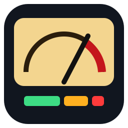

# VU Monitor 2000

Audio level monitoring for HLS streams, built for broadcast and audio engineers.
Put any number of streams on one page and watch left/right levels on
**digital peak meters** or **analogue VU meters**, or switch to **average level
over time**, a **frequency response** analyser or **SNR / dynamic range**
figures, with loudness, phase correlation and silence alarms throughout.



## What it shows

Each stream gets a card with:

| | |
|---|---|
| **Digital meters** | Vertical L/R bargraphs, -60 to 0 dBFS (top 20 dB expanded). True peak (4× oversampled, dBTP) or sample peak. IEC 60268-18 fall-back (20 dB / 1.7 s), peak hold, max-since-reset readout, latching **OVER** at -0.1 dBFS. Green/amber/red zones (default amber from -9, red from -1 dBTP). Alignment level marked. |
| **Analogue VU** | A pair of moving-coil style VU meters with IEC 60268-17 ballistics (99 % in 300 ms, ~1.3 % overshoot), -20 to +3 VU and % scale, peak LED. |
| **Average** | RMS level of L and R over time (1 s points) across a sliding window of 1, 5, 15 or 60 minutes, with the alignment level and **Leq** (energy-average level) drawn on the graph. Readouts: Leq L / R (dBFS), average loudness over the window (LUFS, -70 LUFS gated), loudest and quietest second. |
| **Spectrum** | Frequency response as a 1/3-octave real-time analyser, 31 bands 20 Hz – 20 kHz. Live bars (fast 125 ms or slow 1 s), peak hold, and an amber **long-term average** curve showing the programme's tonal balance since the last reset. Calibrated so a full-scale sine reads 0 dBFS in its band. |
| **SNR / DR** | Over the same sliding window: **SNR (est.)** – loud passages (95th percentile of 400 ms RMS) above the **noise floor** (5th percentile, i.e. the pauses); **dynamic range** – highest true peak above the noise floor; **LRA** (EBU Tech 3342 loudness range); **crest factor** (peak to RMS); **PLR** (peak to loudness). A histogram shows the level distribution with the noise floor, P95 and peak marked. Digital black reads as ∞. |
| **Reference** | 0 VU = -18 dBFS (EBU) by default; also -20 (SMPTE), -24, -16, -14, -12. A sine whose peak is at the reference reads 0 VU. |
| **Loudness** | EBU R128 / ITU-R BS.1770-4 momentary, short-term and gated integrated LUFS. Green within ±1 LU of target (-23 LUFS default, or -24 LKFS OP-59/A85). |
| **Correlation** | Phase correlation, -1 to +1. |
| **Alarms** | Card flashes red on silence (default below -50 dBFS for 10 s), stream error or no audio. Streams reconnect automatically with back-off. |
| **Listen** | Headphone button solos a stream to your speakers; volume in the toolbar. |

Metering runs in the browser and measures every sample (no missed peaks). Over
HTTPS or on `localhost` it runs in an AudioWorklet on the audio thread; over plain
HTTP (e.g. `http://unraid:8080`) browsers disable AudioWorklet, so it falls back
to a ScriptProcessor running the same code on the page's main thread. Readings
are identical. The only difference: on plain HTTP a mono source arrives as two
identical channels, so it shows MONO but reads 3 LU higher in loudness than over
HTTPS. Use HTTPS (e.g. through the Cloudflare tunnel) for a busy wall of streams. Checked against ffmpeg's `ebur128` filter: a -18 dBFS tone
reads 0.0 VU, and loudness and true peak agree to within 0.1 dB.

Keys: `D` digital, `A` analogue, `L` average, `F` spectrum (frequency),
`N` SNR / DR (noise), `R` reset, `1`–`9` listen, `0` stop listening. Click a
meter to reset what it shows (peaks, average, spectrum or statistics); click the
loudness readout to reset integrated loudness. The averaging window and spectrum
speed are in Settings. Add `?kiosk` to the URL to hide the toolbar for a wall
display. Meter settings are saved per browser.

## Admin page

`/admin/` – add, edit, reorder, enable/disable and delete streams. **Test URL**
fetches the URL from the server and tells you what it is (master/media playlist,
variants and codecs, or a direct audio stream). The monitor page picks up changes
within 10 seconds.

Supported: HLS master or media playlists (AAC, MP3, etc.; audio-only or A/V, the
highest-bitrate rendition is monitored) and plain Icecast/Shoutcast MP3/AAC streams.

Set `VUMON_ADMIN_PASSWORD` to protect the admin page (HTTP basic auth, user
`admin` unless `VUMON_ADMIN_USER` is set). If you publish it through a Cloudflare
Tunnel, consider Cloudflare Access on `/admin/` too.

### Why the server proxies streams

Browsers only let the Web Audio API read samples from media that is same-origin or
sent with CORS headers, and most broadcast CDNs don't send them – the meters would
sit at silence. So by default each stream is fetched through the server
(`/proxy`), which rewrites playlist URLs to come back through it. The proxy only
fetches hosts that are in the stream list (and hosts those playlists point to),
so it can't be used to reach anything else. Untick **Route through server** for a
stream that already sends CORS headers.

## Run it

Python 3.11+, no packages needed:

```bash
VUMON_ADMIN_PASSWORD=secret python3 -m vumon
```

Open http://localhost:8080 and click **Start monitoring** (browsers need a click
before audio can start).

| Variable | Default | |
|---|---|---|
| `VUMON_PORT` | `8080` | |
| `VUMON_DATA_DIR` | `./data` (`/data` in Docker) | `streams.json` lives here |
| `VUMON_ADMIN_PASSWORD` | *(none)* | protects `/admin/` |
| `VUMON_ADMIN_USER` | `admin` | |
| `VUMON_LOG_LEVEL` | `INFO` | |

## Docker / Unraid

Every push to `main` builds the image on GitHub Actions (Intel/AMD and ARM) and
pushes it to **`ghcr.io/haftwo/vu-monitor-2000:latest`** – no setup needed. To push
to Docker Hub as well, add repository secrets `DOCKERHUB_USERNAME` and
`DOCKERHUB_TOKEN`. Tag `v1.1` to get a `:1.1` image.

> The ghcr.io package starts **private**. Either make it public (GitHub → your
> profile → Packages → vu-monitor-2000 → Package settings → Change visibility), or
> `docker login ghcr.io` on Unraid with a token that has `read:packages`.

**On Unraid**

1. Copy the template to the flash drive:
   ```bash
   wget -O /boot/config/plugins/dockerMan/templates-user/my-vu-monitor-2000.xml \
     https://raw.githubusercontent.com/haftwo/vu-monitor-2000/main/unraid/my-vu-monitor-2000.xml
   ```
2. Docker tab → **Add Container** → Template: *vu-monitor-2000*.
3. Set the admin password, check the port, **Apply**.
4. To update later: Docker tab → *Check for updates* (or force update).

**docker compose**

```bash
docker compose up -d       # see docker-compose.yml
```

**Build it yourself**

```bash
docker build -t vu-monitor-2000 .
./push.sh <dockerhub-user>        # multi-arch build and push to Docker Hub
```

The image downloads hls.js at build time so the page works without internet
access. Without it the page falls back to the jsDelivr CDN, then to the browser's
own HLS support (Safari, recent Chrome).

## Notes and limits

- Each stream is decoded in the browser, so a page of many streams costs CPU on
  the viewing machine (roughly 1–2 % of a core per audio stream; A/V streams also
  decode video). 20–30 audio streams on one page is fine on a normal desktop.
- Over plain HTTP/1.1, browsers allow 6 connections per host. Icecast streams hold
  one open permanently, so keep to about 5 per page on a LAN – or go through
  Cloudflare/HTTPS (HTTP/2), where this limit doesn't apply. HLS streams aren't
  affected.
- Mono streams are shown on both meters with a MONO badge and counted once for
  loudness. For 5.1 streams the first two channels are metered.
- SNR is estimated from programme, since a live stream carries no test signal:
  it's the gap between loud passages and the quietest 5 % of the window. It needs
  some pauses in the window to find the noise floor; on wall-to-wall programme it
  shows the programme's own dynamics instead. A 1 kHz tone with -80 dBFS noise in
  the gaps reads 59 dB.
- Levels shown are what the browser decodes: after the stream's codec, before
  any output volume.

## Layout

```
vumon/server.py          web server, stream store, HLS proxy, URL tester
vumon/web/index.html     monitor page
vumon/web/monitor.js     stream playback, reconnects, UI
vumon/web/meters.js      ballistics and canvas drawing (digital + analogue)
vumon/web/stats.js       average level, Leq, SNR / noise floor, LRA, crest, PLR
vumon/web/spectrum.js    1/3-octave frequency response analyser
vumon/web/meter-dsp.js   sample-accurate peak / true peak / VU / RMS / BS.1770 / correlation
vumon/web/meter-worklet.js  AudioWorklet wrapper (HTTPS / localhost)
vumon/web/admin.*        admin page
unraid/                  Unraid container template
```

hls.js is © its authors, Apache License 2.0.
